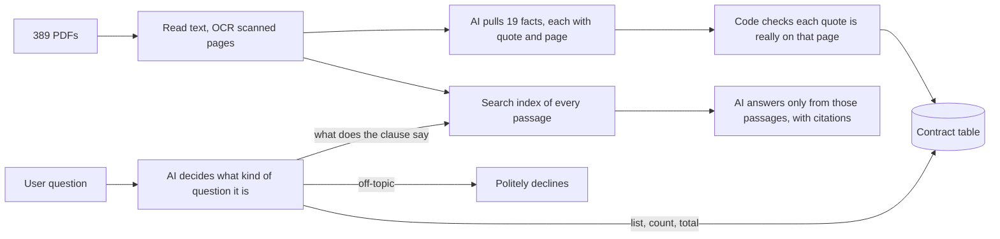

# Contract Intelligence PoC

Berkshire Partners take-home. This tool reads the Lake County, Illinois procurement archive (389 files, 381 unique
documents) and turns it into a searchable table of 19 key facts per contract. Every fact links to the exact
sentence and page it came from. A deal team can then ask questions in plain English and get a chart or list, a
quoted answer with page numbers, or a plain "the documents don't say."

## Try it

Open **[berkshire-contracts.fly.dev](https://berkshire-contracts.fly.dev/)** and sign in with the username and
password you were given. Nothing needs to be installed.

To run it on your own computer instead, install [uv](https://docs.astral.sh/uv/getting-started/installation/),
then from this folder:

```bash
uv sync                    # installs everything (a few minutes the first time)
cp .env.example .env       # add your OPENAI_API_KEY
uv run python app.py       # opens at http://127.0.0.1:7860
```

Without an OpenAI key, everything except written chat answers still works. Rebuilding from the raw PDFs, hosting,
Slack and Teams, the daily email and all settings are in
[docs/setup-and-operations.md](docs/setup-and-operations.md).

## What's inside

- **Executive overview:** headline counts and charts: document types, who controls renewal, upcoming end dates,
  biggest vendors.
- **Ask the contracts:** the chat. Answers cite file and page, and the cited page opens beside the answer.
  Data questions also return a table, a chart and a CSV download.
- **Contract explorer:** filter the documents and open any one to see every fact with its quote and page.
- **Data quality and evaluation:** what was read, what needs review, test results and AI cost.
- **The database:** `data/contracts.db` (SQLite) has one row per file, plus a quote and page behind every value.
  The same data is in `data/exports/contracts.xlsx` and CSV files.

## What it pulls out of each contract

The 19 facts answer the four questions a deal team asks of any contract book:

| Question | Facts |
|---|---|
| What is it, and with whom? | contract number, document type, vendor, description |
| When does it end, and who decides? | start and end dates, renewal type and options, auto-renewal, renewal notice |
| What is it worth? | award amount, how pricing works |
| What if it goes wrong? | right to cancel without cause, cancellation notice, liability cap, indemnity, insurance, governing law, transfer to a new owner |

End dates, renewal rights and notice periods matter most, because they create deadlines someone has to act on.

## How it works



Three rules keep it trustworthy:

1. **Evidence first.** The AI must quote the sentence and page before giving a value, and code checks the quote.
   A blank is preferred to a guess.
2. **The AI never does the math.** For counts, totals and lists it only describes what to look up; ordinary code
   does the filtering and adding, so the same question always gives the same number.
3. **Refuse rather than guess.** If the passages don't answer the question, it says so.

The technical detail behind each step is in [docs/how-it-works.md](docs/how-it-works.md).

## How well it works

All results are in [eval/results/report.md](eval/results/report.md). The answer key was checked by a person
against the PDFs before any results were seen.

| Test | Result |
|---|---|
| Table accuracy: 100 values (10 documents × 10 key facts) | **95 of 100 right** (likely range 89–98%) |
| Values made up for facts the document doesn't state | 4 of 38 |
| Chat: 6 answerable questions, graded by a person | **6 of 6 right**, every claim backed by a cited page |
| Chat: questions it should refuse (fake vendor, missing clause, off-topic) | 3 of 3 refused; 0 of 7 good questions wrongly refused |
| AI grader agreeing with the person | 9 of 9 |
| Typical chat answer | about 4 seconds and $0.001 |

How to read this:

- **The chat score improved after fixes.** The first person-graded run got 1 of 6 fully right. Most failures came
  from pointing the question at the wrong contracts, not from the search or the AI's writing. Those were fixed and
  all 10 questions were re-run from scratch. Because the fixes were made after seeing these questions, a fresh set
  of questions is the real test; one has been drafted (`eval/holdout`, kept local).
- **Small samples.** Ten documents and ten questions show where the system fails; they are not precise rates.
- **Search comparison.** A [retrieval benchmark](eval/results/retrieval_benchmark.md) compares the word-by-word
  search used here with plain keyword search, with no AI involved. Across all documents, it put the right page
  first for 4 of 5 clause questions versus 2 of 5 for keyword search. Finding a fact's page inside a known
  document, keyword search did about as well (59 vs 56 of 62 in the top 8). Each method missed questions the other
  found, so combining them is the next step.

## Known limitations

- A table stored as an image on a page that also has normal text isn't read (one missed $48,000 fee).
- Terms in an attachment, such as a subcontractor's agreement, can be read as the County's own terms.
- Each document is read on its own: an amendment that extends a contract doesn't yet update that contract's end
  date.
- Free-text facts (description, renewal options, liability cap, insurance) aren't scored yet.
- Built for a demo: one small server and a single-file database, not many users at once.

## What I'd do next

1. **A review queue and a bigger answer key.** Send risky values (attachments, long documents, low confidence,
   high-dollar fields) to a person in the app; their corrections fix the data and become new test cases.
2. **One "current state" per contract.** Merge each agreement with its amendments and renewal letters into one
   current end date, value and notice deadline, the basis for an act-by calendar.
3. **Production setup.** Combined keyword and word-by-word search, a server database, company sign-in with
   per-deal access, a private model endpoint, and automatic test runs before every release.

## How AI was used

AI was used for implementation acceleration and initial label drafting. I selected the architecture, reviewed
generated code, verified labels against PDFs, and designed the evaluation.
