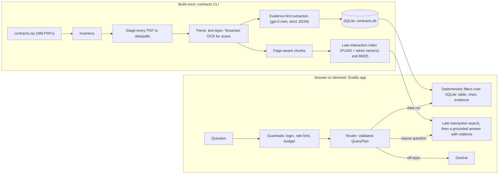

# Contract Intelligence PoC

Berkshire Partners take-home. The pipeline turns the Lake County, Illinois procurement archive — 389 files,
381 unique documents — into an inspectable database of 19 evidence-backed fields. A non-technical deal team can
then ask questions in plain English and get data cuts with charts, clause answers with page citations, or a plain
statement that the documents don't say.

- **Late-interaction retrieval** (ColBERT-style, via PyLate and FastPLAID) answers clause questions, chosen for its
  precision on contract wording.
- **Evidence-first extraction**: every value carries a verbatim quote, a page number, a confidence level, and the
  model and prompt version that produced it.
- **No model-written SQL**: the model fills in a validated query plan and deterministic code runs it.
- **Measured against a human-checked answer key**: table extraction and chat answers are scored on 10 documents
  and 10 questions, with every failure traced to a cause ([`eval/results/report.md`](eval/results/report.md)).

## Try it

Open **[berkshire-contracts.fly.dev](https://berkshire-contracts.fly.dev/)** in a browser and sign in with the
username and password you were given. Nothing needs to be installed.

To run it locally instead, you need [uv](https://docs.astral.sh/uv/getting-started/installation/), which installs
Python 3.12 if it's missing. From the unzipped submission folder:

```bash
uv sync                    # virtualenv with all dependencies; a few minutes the first time (PyTorch is large)
cp .env.example .env       # add OPENAI_API_KEY; set APP_USERNAME/APP_PASSWORD to require a login
uv run python app.py       # prints the local URL, normally http://127.0.0.1:7860
```

The first start downloads the retrieval model (about 130 MB) from Hugging Face. Without an OpenAI key, the
overview, explorer and data-quality tabs work fully, and chat shows the most relevant passages instead of a written
answer. Developed and tested on macOS with Apple silicon. The dependencies also publish wheels for x86-64 Linux and
Windows, but those haven't been tested; Intel Macs aren't supported because current PyTorch has no build for them.

The submission includes `data/`: the database, the index, the staged PDFs and the exports. It is generated and
kept out of version control because it contains contract text. `uv run python scripts/package_submission.py` builds
the submission zip (`dist/contract-intelligence.zip`) and refuses to include `.env`, `contracts.zip`, the brief or
any secret value set in `.env`. To rebuild `data/` from `contracts.zip`, see
[Rebuild from the raw contracts](#rebuild-from-the-raw-contracts).

The app has four tabs:

| Tab | What it does |
|---|---|
| Executive overview | Headline counts; charts of document types, renewal control, term ends, vendors, risk terms and field coverage; upcoming term ends with the date to act on notice |
| Ask the contracts | Chat. Answers cite file and page, and the cited page opens beside the answer with the quote highlighted. Data cuts add a table, a chart and a CSV download. |
| Contract explorer | Filter the documents, open any one to see every field with its quote, page image and original PDF |
| Data quality & evaluation | Parse and extraction status, review flags, evaluation results, model cost by purpose; downloads of the exports and the SQLite database |

Example questions: "Which contracts have auto-renewal clauses?", "Which contracts expire in 2026? Show a timeline.",
"What does the Motorola site lease say about renewal and notice?", "Total stated award value by vendor".

## The database

`data/contracts.db` is SQLite and opens in any SQLite browser or with `sqlite3`. It has one row per contract file,
and every value can be traced back to its source.

| Table | Rows | Contents |
|---|---|---|
| `contracts` | 389 | One row per file: the 19 fields, parse and extraction status, review flags, model and prompt version |
| `field_evidence` | 7,391 | One row per file and field: value, verbatim quote, page, confidence, whether the quote was found in the source |
| `pages` | 4,530 | Page text, whether it came from the text layer or OCR, OCR confidence |
| `chunks` | 12,825 | Retrieval passages with page and section heading |
| `corpus_files` | 389 | Inventory of the whole archive: text profile, encryption, contract family, duplicates |
| `llm_calls` | — | Every model call: purpose, model, prompt version, tokens, cost, latency, cache hit |
| `chat_logs` | — | Every question: route, query plan, retrieved passages, answer |
| `pipeline_runs` | — | Every pipeline step with status and statistics |

The same data is exported to `data/exports/contracts.csv` (one row per file), `contracts.xlsx` (with a data
dictionary) and `field_evidence.csv`. The exports and the database file can all be downloaded from the app's Data
quality tab.

## The 19 fields

The fields answer the four questions a deal team asks of any contract book. Definitions, extraction instructions and
business use are in [`src/berkshire_contracts/extraction/fields.py`](src/berkshire_contracts/extraction/fields.py).

| Question | Fields | Decision it drives |
|---|---|---|
| What is it, and with whom? | contract number, document type, vendor, description | Spend map, vendor concentration, linking letters and amendments into contract families |
| When does it end, and who decides? | effective date, expiration date, renewal type, renewal options, auto-renewal, renewal notice days | Renewal calendar and act-by dates; which revenue sits at the customer's discretion |
| What is it worth? | award amount, pricing basis | Committed versus stated value, price benchmarking |
| What if it goes wrong? | termination for convenience, termination notice days, liability cap, indemnification, insurance requirements, governing law, assignment / change of control | Revenue durability, risk transfer, change-of-control consents in a transaction |

**Non-negotiable:** term end, renewal mechanism, notice periods and termination rights, because they create dated
actions; the evidence behind every value; and refusing to answer rather than guessing. **Roadmap fields:** pricing
schedules and escalators, SLAs and penalties, insurance by coverage line, payment terms, key personnel.

## Architecture



### Offline pipeline

Every step is resumable and logged to `pipeline_runs`.

1. **Inventory**: profile all 389 PDFs inside the zip. This records text layer versus scan, encryption, upload
   wrappers, malformed files, exact duplicates, and contract families inferred from file-name contract numbers.
2. **Stage**: copy every PDF out of the zip into `data/pdfs`, stripping the upload wrapper (bytes before the PDF
   header). A staged file whose name is no longer in the archive is deleted. The processed set is the whole
   archive: 389 files, 381 unique documents, and 8 exact duplicates.
3. **Parse**: read the PyMuPDF text layer first, then run Tesseract OCR (LSTM, 300 dpi, orientation detection) on
   pages with little or garbled text. 1,648 of the 4,530 pages were OCR'd. 22 documents parsed partially and were
   flagged; none failed.
4. **Chunk**: build page-bounded, heading-aware passages (at most 230 tokens, 40 overlapping) sized to the
   retrieval model's 300-token window.
5. **Extract**: make one structured-output call per document. Documents over 160k characters instead get their
   first and last pages plus the pages that best match each field. Each field returns a status, value, verbatim
   quote, page and confidence. Quotes are checked against the page text, dates and renewal terms are checked for
   consistency, and flagged fields are re-read once with more reasoning effort (25 documents). Exact duplicates copy
   their twin's values. 32 documents carry review flags: unverified quote, low confidence, inconsistent dates,
   contract number differing from the file name, partial parse, or low OCR confidence.
6. **Index**: encode passages with `lightonai/answerai-colbert-small-v1`, which keeps a 96-dimensional vector per
   token (2,103,458 vectors, 657 MB on disk). Build a FastPLAID index for candidate search and a BM25 index as the
   baseline.
7. **Export** the CSV and XLSX files, then **evaluate**.

### Answering a question

- **Router** (gpt-5-mini, low reasoning effort): returns a Pydantic-validated `QueryPlan`. The plan holds the route,
  filters on an allowlist of fields and operators, grouping, metric, named contracts or vendors, the fields the
  answer needs, and a search query. If the router fails, the app searches the text directly.
- **Data cuts**: deterministic filters over the `contracts` table. Award totals are de-duplicated by contract family
  and vendor, so restatements and task orders count once. Documents that don't state a field are reported as
  unknown, never counted as "no". Small results list each document with the asked-for value and its quote. A named
  contract number outranks a vendor name, and a vendor name matches only when all its words match; a vendor plus
  product ("Grey Wall Veoci") matches that vendor's documents that mention the product. If the planner's
  descriptive filters (document type, description) remove every named document, they are dropped; if other
  filters do, the app searches those documents' text. If a named vendor or contract isn't in the extracted data,
  the app searches only the documents whose pages or file names mention it. If none does, it says so without
  calling the model, rather than answer from other contracts.
- **Clause questions**: PLAID returns 200 candidates, which are re-scored with exact MaxSim on full-precision token
  vectors. The top 8 passages (capped per file for diversity) pass a relevance gate before the answer model sees
  them. The answer model (gpt-5-mini) must use only those sources, cite every sentence as `[S#]`, and say so when the
  sources don't answer. Citations are checked against the passages actually provided.
- **Hybrid**: filter in the database first, then search clauses within the matching documents (for example,
  "for leases, what happens to the equipment at the end?").

### Design decisions

- **Late interaction over single-vector or keyword search.** Contract questions hinge on exact terms: notice days,
  party roles, dollar caps. MaxSim compares every query token with every passage token, so specific wording isn't
  averaged away, and paraphrases still match. "Twenty million dollars" finds "$20,000,000", and "walk away early
  without a reason" finds the termination-for-convenience clause; BM25 misses both. The cost is memory: one vector
  per token instead of one per passage. PLAID compression keeps candidate search scalable, and the exact rerank
  restores full precision on the shortlist. The app searches with PLAID plus that exact rerank; `RETRIEVAL_MODE`
  switches to PLAID alone, exact MaxSim or BM25.
- **A relevance gate that measures the question's own words.** Full MaxSim scores include about 25 query-expansion
  ([MASK]) tokens that match almost anything, so off-topic questions scored about as high (≈0.95 normalized) as
  answerable ones. The gate instead uses the mean best match over the question's own tokens. Its threshold (0.88)
  was set below every answerable question in an earlier test set, so it only skips clearly off-topic questions;
  the answer model's evidence check handles the rest.
- **Evidence before values.** The model has to quote the clause and page before giving a value. This makes every
  value checkable in one click and lets the pipeline verify quotes automatically (99.8% of the 3,775 extracted values
  verify). A blank is preferred to a guess.
- **No generated SQL.** The model only fills a typed plan; code executes it. Counts are reproducible, the database
  can't be injected into, and the plan is logged for audit.
- **Inspectable storage.** SQLite plus CSV/XLSX: reviewers can open the data without any infrastructure.
- **Cheap by design.** gpt-5-mini for every step, a response cache, client-side rate pacing and a daily budget cap
  (see [Cost](#cost)). gpt-6-luna is cheaper per token, but this account's OpenAI tier limits it to about 9 requests
  a minute. Once the tier allows, switch back with one setting per step, e.g. `EXTRACTION_MODEL=gpt-6-luna`.

## Error handling and graceful failure

- **Files**: encrypted PDFs are opened with the empty user password, upload wrappers (bytes before the PDF header)
  are stripped, and malformed files are repaired. Pages with no usable text are OCR'd; documents that still have
  gaps are marked `partial` and flagged. No file failed to load.
- **Model calls**: retried with backoff and paced under the account's request and token limits. Failures are
  recorded per document without stopping the run, and every call is logged with cost and latency.
- **Questions**: empty, overlong (over 600 characters) and too-frequent (over 6 a minute per session) questions get a
  clear message. Off-topic questions are declined. Weak evidence produces "the documents provided don't cover it",
  usually naming the closest documents. An answer that cites nothing carries a warning.
- **Outages and budget**: if the router fails, the app searches the text directly. If answer synthesis fails, or the
  daily AI budget is reached, the app shows the most relevant passages instead of an answer. Without an API key,
  the overview, explorer and data-quality tabs keep working and chat degrades to passage search.
- **UI**: stack traces are never shown to users; errors are logged on the server.

## Evaluation

The answer key is in [`eval/ground_truth/`](eval/ground_truth) and the results are in
[`eval/results/`](eval/results); [`report.md`](eval/results/report.md) lists every case and failure. The AI
assistant that built the pipeline drafted the labels from the page text, and a person checked every one against the
PDF before any results were seen. No label was changed afterwards.

| Test set | Size | What it covers |
|---|---|---|
| Table extraction | 100 values: 10 documents × 10 fields | Documents sampled at random within each document type, five scanned and five digital, including fields the document doesn't state, which should stay blank |
| Chat | 10 questions | A list question, a date filter, four clause lookups, one question combining the table and a clause, and three the documents can't answer (a missing contract, a missing clause, an off-topic question) |

**Running it.** `uv run contracts evaluate` scores the table against the labels and runs the chat questions fresh,
never reusing cached model output. A person then grades each answer in `eval/results/chat_grading.csv` (an easier
view is `chat_grading.md`), and `uv run contracts evaluate --report-only` rescores without calling any model. See
[`eval/ground_truth/README.md`](eval/ground_truth/README.md).

**Metrics and why.**

- **Table extraction** is scored by code, with no AI grader, so the score is reproducible: amounts within 0.5%,
  dates, day counts, yes/no and document type exactly, vendor names ignoring suffixes like "Inc.".
  - Accuracy, counting correct blanks: does the table say the right thing?
  - Precision and recall on stated values, reported separately because the errors cost differently: a wrong value
    misleads, a blank only sends the reader to the PDF.
  - Values invented for fields the document doesn't state: the hallucination measure.
  - Quote verification and page accuracy: can a reviewer check the value in one click?
- **Chat** is graded by a person, because ten answers are few enough to read.
  - Correct and supported (every claim backed by a cited page) are graded apart, because a right answer with no
    support can't be trusted.
  - Declines are scored both ways: an assistant that refused everything would ace the unanswerable questions.
  - Whether the expected page was found and the expected document cited, which separates search failures from
    answer-writing failures.
  - Latency and cost per question, because a slow or expensive answer fails in use.
  - An AI grader gives a blind second opinion; its agreement with the person shows how far it can be trusted to
    screen answers at scale.

| Area | Metric | Result |
|---|---|---|
| Table extraction | Accuracy, including correct blanks (95% range) | 95% (89–98%) |
| | Precision / recall on stated values | 94% / 98% |
| | Values invented for fields the document doesn't state | 4 of 38 |
| | Scanned / digital documents | 92% / 98% |
| | Quotes verified verbatim / cited page exact | 100% / 100% |
| Chat | Answers fully correct (and partly correct) | 1 of 6 (2 more) |
| | Answers whose claims are all backed by a cited page | 4 of 4 |
| | Unanswerable questions declined / answerable ones wrongly declined | 2 of 3 / 2 of 7 |
| | Expected page found / expected document cited | 4 of 6 / 3 of 6 |
| | List question precision / recall; date filter | 100% / 89%; correct |
| | Median / p90 latency, mean cost | 4.35 s / 11.73 s, $0.0015 per question |
| | AI grader agreeing with the person on correctness | 8 of 9 |

The chat figures above are from the graded run before the scoping fixes, kept in
[`eval/results/run2_before_scope_fix/`](eval/results/run2_before_scope_fix). The current
[`report.md`](eval/results/report.md) reruns all ten questions after the fixes. The AI grader marks every answer
correct there, but a person hasn't graded it yet.

**What the results say.**

- **The table is reliable; the chat layer is the weak link.** The five extraction errors have three causes:
  - an attached subconsultant agreement read as the County's terms (three errors, all in one task order);
  - a fee table stored as an image on a page with a text layer, so it was never OCR'd;
  - a signature date taken as an effective date.
- **Most chat failures happen before the answer is written.**
  - Three questions were scoped to the wrong documents by the planner. One vendor name matched nothing ("Grey
    Wall Veoci"), a loose match on "Associates" summed three contracts, and a lease recorded as an "agreement" was
    dropped by the planner's lease filter.
  - Twice the answer step failed. Once it declined although the answer was the top search result; once it
    presented another contract's price clause as the Starbucks agreement's.
  - One answer missed Axon's auto-renewal. Extraction read the 129-page contract in excerpts that included the p.97
    "will automatically renew" clause, but the model recorded a Sourcewell extension clause on p.1 instead.
  - Fixes since then: contract numbers outrank vendor names, and vendor names must match word for word. Planner
    filters that drop every named document are relaxed. Documents titled as leases are typed as leases, and explicit
    "will automatically renew" wording sends a "no auto-renewal" value to a high-effort re-read.
- **Confidence alone is not a review trigger.** Two of the four invented values were marked high confidence. Review
  should also target attached terms, long documents and high-value fields.

**Caveats.**

- Ten documents and ten questions, each chat question run once. Chat answers change between runs: two of the ten
  differed between a discarded first run and the graded one. One answer moves a chat figure by 17 points, so read
  the chat results as a map of where it fails, not as rates.
- Only ten fields with clear right answers are scored. Free-text fields (description, renewal options, liability
  cap, insurance) are not.
- One person checked the labels and graded the answers. The AI grader is the same model family as the pipeline;
  set `JUDGE_MODEL` to another family when quota allows.

### Monitoring in production

- **Release gate**: rerun this test set fresh on every prompt, model or parser change, and weekly with no change to
  catch provider-side drift. Block a release that lowers accuracy or declines, or raises invented values. Prompts
  are versioned in the database; pin dated model snapshots rather than aliases.
- **Drift signals, weekly**, all derivable from `field_evidence`, `llm_calls` and `chat_logs`:
  - per-field fill rate and quote-verified rate;
  - OCR share and OCR confidence;
  - document-type mix;
  - the top retrieval score per question;
  - refusal rate, uncited answers and route mix;
  - cost and latency per question.

  A drop in one field suggests new templates or clause wording; a drop across fields points to the model or prompt.
- **Human audit**: a person grades a weekly sample of real questions, with the AI grader screening more;
  grader-human agreement decides how far the grader is trusted. Answers users mark wrong and documents unlike
  anything in the test set become new test cases.

## Guardrails and human checkpoints

Built:

- Evidence on every value, and a one-click source page.
- Refusal over guessing: a relevance gate, the answer model's insufficient-evidence flag, citation validation, and a
  warning on uncited answers.
- Query plans restricted to an allowlist, with no generated SQL.
- Document text treated as data in every prompt, as a prompt-injection defense.
- Review flags, which the explorer can filter on.
- Login, a per-session rate limit, a question length limit and a daily AI budget.
- Audit logs of every question, plan, source and model call.

Proposed:

- Human sign-off before an extracted value enters an investment committee memo.
- A second reviewer for award, termination and liability values.
- A review queue in the app.

## Security and confidentiality

- **Secrets** live only in `.env`, which is git-ignored and never packaged. They are loaded as `SecretStr` and never
  logged.
- **Source material** stays on the local machine. `contracts.zip` and the brief are git-ignored. The packaging
  script ships the staged PDFs (the whole archive) and data derived from them, leaves out the response cache, and
  refuses to write the zip if it would contain `.env`, any `.zip`, the brief, or a secret value set in `.env`.
- **Model provider**: OpenAI Responses API calls use `store=false`. For production, use a zero-data-retention
  agreement or Azure OpenAI inside the firm's tenant, over private networking.
- **Access**: the app listens on 127.0.0.1, so only the machine running it can reach it. `APP_USERNAME` and
  `APP_PASSWORD` add a login, which becomes the real gate if the app is ever exposed (`GRADIO_SERVER_NAME=0.0.0.0`
  or hosting) and then needs a strong password. A per-session rate limit and a daily AI budget cap limit the damage
  a leaked login could do. For production: SSO with per-deal access control, encryption at rest, retention limits,
  and the existing audit tables.

These are public procurement records, but the design assumes deal-confidential documents.

## Limitations

- The test sets are small (10 documents, 10 questions), and chat answers are not yet reliable: 1 of 6 was fully
  right in testing (see [Evaluation](#evaluation)).
- On scanned pages, the quote is shown above the page image rather than highlighted on it.
- De-duplicating awards across restatements and task orders (by family and vendor, keeping the largest) is a
  heuristic.
- Each document is extracted on its own. There is no "current state" per contract family yet: an amendment that
  extends an agreement doesn't update that agreement's end date.
- The router's scoping was the weakest step: three of the six graded chat failures came from scoping the question
  to the wrong documents. The fixes cover those cases, but the router still varies from run to run.
- The app is a single local process on SQLite with on-device model inference: fine for a demo, not for many
  concurrent users.

## Top three improvements

1. **A human review queue and a larger answer key.** Send flagged values (attached terms, long documents, low
   confidence, unverified quotes, high-value fields) to reviewers who confirm or correct them in the app.
   Corrections update the database and become test cases, growing the answer key beyond 10 documents.
2. **A contract-family "current state".** Merge each agreement with its amendments, renewal letters and task orders
   into one current term, value and notice date. That is the basis for an act-by calendar and for committed rather
   than stated value.
3. **A production platform**, consisting of:
   - hybrid retrieval (BM25 plus late interaction, so exact names and paraphrases both match);
   - Postgres with a managed vector index;
   - SSO with per-deal access;
   - an in-tenant model endpoint;
   - a Microsoft Teams bot on the same API;
   - continuous integration gated on the evaluation.

## Rebuild from the raw contracts

Put `contracts.zip` in the project root. OCR is an optional dependency group because only the parse step uses it.
Its `tesserocr` wheel bundles Tesseract on macOS 15+ and Linux; elsewhere, `uv sync --group ocr` builds it from
source, which needs Tesseract and its headers installed first (`brew install tesseract`, or
`apt install libtesseract-dev`).

```bash
uv sync --group ocr
uv run contracts setup-ocr     # English LSTM and orientation models into data/tessdata
uv run contracts inventory     # profile all 389 PDFs in the zip
uv run contracts stage         # copy every PDF into data/pdfs
uv run contracts parse         # text layer plus OCR
uv run contracts chunk
uv run contracts extract       # about $4.40 with gpt-5-mini; cached and resumable
uv run contracts index         # downloads the retrieval model on first run
uv run contracts export
uv run contracts evaluate      # about $0.03: ten fresh chat answers plus the AI grader
uv run contracts status        # what is in the database, including total model spend
uv run contracts ask "Which contracts auto-renew?"
uv run python scripts/package_submission.py   # reviewer zip in dist/
```

**Hosting on Fly.** `scripts/deploy_fly.py` publishes the app to `https://berkshire-contracts.fly.dev`. It does
not use `fly launch`. The image includes the database, index and staged PDFs. Secrets stay in Fly and are not
printed. `MCP_TOKEN` in `.env` is the bearer token for `https://berkshire-contracts.fly.dev/mcp`, which Claude
Tag calls. The `claude-tag/` folder is the plugin to attach in the Claude Tag admin console for the Slack
workspace. `presentation/` is not part of the image.

```bash
uv run python scripts/deploy_fly.py
```

## Configuration

Settings come from environment variables or `.env`; defaults are in
[`src/berkshire_contracts/config.py`](src/berkshire_contracts/config.py).

| Variable | Default | Purpose |
|---|---|---|
| `OPENAI_API_KEY` | — | Extraction, chat answers and judged evaluation (without it, chat shows passages) |
| `APP_USERNAME`, `APP_PASSWORD` | unset | App login (no login screen when unset) |
| `MCP_TOKEN` | unset | Bearer token for the Fly `/mcp` endpoint (Claude Tag) |
| `EXTRACTION_MODEL`, `ESCALATION_MODEL`, `ROUTER_MODEL`, `CHAT_MODEL`, `JUDGE_MODEL` | `gpt-5-mini` | Model for each step |
| `MAX_QUESTIONS_PER_MINUTE` | 6 | Per-session rate limit |
| `DAILY_LLM_BUDGET_USD` | 5 | Daily cap on chat spend |
| `LLM_RATE_LIMITS` | per model | Client-side requests and tokens per minute, matched to the OpenAI tier |
| `RETRIEVAL_MODE` | `plaid_rerank` | `plaid_rerank`, `plaid`, `exact` or `bm25` |
| `COLBERT_DEVICE` | auto | Force `cpu`, `cuda` or `mps` for the retrieval model |

## Cost

Building and evaluating everything cost **$4.64** in OpenAI usage across 600 API calls (cache hits excluded):

| Item | Cost |
|---|---|
| Extraction of 389 documents, including escalations | $4.41 |
| AI grader calls during evaluation | $0.11 |
| Routing and answers across all testing | $0.11 |

A typical question costs about $0.0015. `uv run contracts status` and the app's data-quality tab show live totals.

## Repository layout

```
app.py                         Gradio app (four tabs)
src/berkshire_contracts/
  cli.py                       `contracts` pipeline commands
  config.py                    settings from the environment or .env, model prices
  db.py                        SQLite schema (SQLAlchemy)
  schemas.py                   Pydantic schemas for model outputs and query plans
  ingestion/                   inventory, staging, PDF repair, parsing and OCR, chunking
  extraction/                  field definitions, prompts, OpenAI client (structured outputs, cache, cost), extractor
  retrieval/                   late-interaction encoder; PLAID, exact MaxSim and BM25 search
  chat/                        router, deterministic filters, grounded answers, assistant service
  evaluation/                  answer-key loading, scoring, grading sheet, report
  app_support.py               overview charts, page rendering with highlights
  exports.py                   CSV and XLSX exports
eval/ground_truth/             human-checked answer key
eval/results/                  report.md, summary.json, per-case CSVs, chat grading sheet, failure causes
scripts/package_submission.py  build the reviewer zip: code plus prebuilt data, no secrets
scripts/deploy_fly.py          publish to Fly.io (https://berkshire-contracts.fly.dev)
claude-tag/                    plugin and skill for Claude Tag in Slack
tests/                         offline unit tests (throwaway database, no model calls or downloads)
data/                          generated, not in version control: database, index, staged PDFs, exports
```

Run the tests with `uv run pytest`.

## Troubleshooting

- **`ModuleNotFoundError: berkshire_contracts` on macOS.** The editable install's `.pth` file can end up with the
  hidden file flag, and Python skips hidden `.pth` files. Either prefix commands with `PYTHONPATH=src` or clear the
  flag with `chflags nohidden .venv/lib/python3.12/site-packages/*.pth`.
- **The first question is slow.** The retrieval model loads on first use; the app warms it up at start.
- **OpenAI 429 errors.** Lower `LLM_RATE_LIMITS` to your account's tier; calls retry with backoff.
